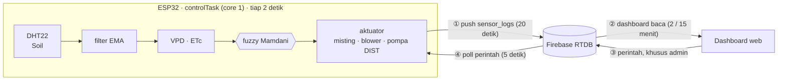

# Smart Greenhouse Firmware

Firmware ESP32 untuk penyiram dan iklim otomatis greenhouse cabai merah: membaca
sensor, memutuskan tindakan lewat fuzzy logic, menggerakkan pompa, penyiram
kabut, dan kipas, lalu mengirim telemetri ke Firebase Realtime Database.

Dashboard web-nya repo terpisah:
[smartgh-manager](https://github.com/will-zx/smartgh-manager), live di
**https://smartgh-manager.pages.dev/**.

## Akses dan RTDB

Dua jenis akun: **perangkat** (satu per ESP32, dipakai firmware untuk push
telemetri dan menerima perintah) dan **admin** (dipakai dashboard untuk menulis
perintah, label, dan setpoint). Rules RTDB memakai allowlist UID, bukan pola
email: provider Email/Password tidak punya tombol matikan-pendaftaran, jadi
apiKey publik cukup untuk membuat akun baru — allowlist UID membuat akun
sembarang nol akses. Pembacaan telemetri dibuka publik karena isinya hanya data
sensor.

Menambah unit greenhouse: isi `DEVICE_ID` di `firmware/src/secrets.h`,
tambahkan baris di `ZONES` pada `smartgh-manager/src/config.js`, lalu masukkan
UID perangkat itu ke allowlist rules. Rules versi published dan cara
memasangnya ada di
[`docs/rtdb.md`](https://github.com/will-zx/smartgh-manager/blob/main/docs/rtdb.md).

`status_sistem` yang dikirim perangkat berisi label aksi plus penanda gangguan
di ujungnya (`Misting + Blower ON SOILERR NOSYNC`). Dashboard memisahkan
keduanya, jadi tiap penanda tampil sebagai badge sendiri: `SOILERR` (sensor
tanah tidak terbaca), `NOSYNC` (jam perangkat belum sinkron), dan `IRRIGOFF`
(irigasi otomatis dimatikan perangkat sampai debit pompa dikalibrasi, sementara
perintah manual tetap mematuhi safety gate fertigasi). Kini `IRIGOFF` hanya berarti gate otomatis
dinonaktifkan; alasan tahan siklus (misalnya kapasitas tangki belum diisi)
dikirim pada `fertigation_result` dan `irigasi_alasan_tahan`.

## Hardware

Mikrokontroler: ESP32 DevKit v1, framework Arduino via PlatformIO, dua task
FreeRTOS.

### Sensor

| Sensor | Antarmuka | Pin | Output |
| --- | --- | --- | --- |
| DHT22 (suhu dan kelembapan) | Digital one-wire | DATA GPIO 4 | Interval baca minimal 2 detik |
| Tiga probe soil kapasitif | Analog (ADC1) | GPIO 34 / 33 / 39 | 0-100 % (ADC terbalik) |

Ketiga probe dibaca bergantian (jeda 10 ms), lalu rata-rata probe yang **valid**
dipakai keputusan irigasi. Tiap probe tetap dilaporkan terpisah (`soil2`,
`soil3`) supaya polybag yang mengering lebih dulu kelihatan, dan statusnya
dikirim eksplisit sebagai bitmask `soil_ok` + jumlah probe `soil_n` — tanpa dua
field itu, probe yang tercabut tidak bisa dibedakan dari record firmware lama
karena nilai NaN dibuang dari JSON.

Semua pin analog wajib di **ADC1**. Selama WiFi aktif, ADC2 (GPIO 0, 2, 4,
12-15, 25-27) tidak bisa dipakai, jadi soil menempati 34/33/39 dan pompa DIST
memakai 32 (digital). GPIO 36 tetap bebas. GPIO 34, 35, dan 39 input-only,
tanpa pull-up internal.

DHT22 disuplai 3,3 V; hubungkan DATA ke GPIO 4 dan pasang pull-up eksternal
4,7-10 kΩ ke 3,3 V jika modul belum memilikinya. GPIO 4 dipakai sebagai pin
digital; batas ADC2 hanya berlaku bila digunakan sebagai input analog saat WiFi aktif.

### Aktuator

| Aktuator | Pin | Sinyal | Fungsi |
| --- | --- | --- | --- |
| Misting | GPIO 26 | Digital | Penyiram kabut |
| Blower (2 kipas paralel) | GPIO 25 | PWM 1 kHz, 8-bit | Ventilasi |
| FILL | GPIO 27 | Digital | Tandon air ke tandon pencampuran |
| Dosing A | GPIO 13 | Digital | Stok A ke tandon pencampuran |
| Dosing B | GPIO 14 | Digital | Stok B ke tandon pencampuran |
| DIST | GPIO 32 | Digital | Tandon pencampuran ke tanaman |

Setiap kanal lewat satu modul **XY-MOS 400 W** (umumnya aktif-HIGH; modul
aktif-LOW cukup dengan `MOSFET_INVERTED 1` di `config.h`). Hanya blower yang
benar-benar butuh PWM: XY-MOS punya spesifikasi 0-20 kHz dan pada 25 kHz kipas
hanya mau berputar di duty 100 %, sehingga LEDC disetel **1 kHz** dan kontrol
proporsional bekerja penuh. Kipas baru mulai berputar sekitar 20 % duty (mati di
~13 %), jadi level fuzzy di bawah itu dinaikkan ke `BLOWER_MIN_DUTY` (0,20)
sebelum ditulis ke PWM.

Debit awal terbaru dari pengukuran pengguna: FILL/DIST 125,36 L/jam dan dosing
A/B 15,79 L/jam. Belum diverifikasi ulang di hardware; lihat `FERTIGATION.md`
untuk koreksi debit, wiring, batas dosing, dan prosedur commissioning.

### Catu daya dan pengkabelan

Dua PSU terpisah; outputnya jangan diparalel dan jangan digabung jadi satu.

| PSU | Beban | Margin |
| --- | --- | --- |
| 12 V 5 A | blower 0,6 A + misting 0,3 A + DIST (worst-case realistis ~1,2 A) | ~4× |
| 5 V 2 A | ESP32, LCD + backlight | ~4× |

- **GND kedua PSU disatukan di satu titik.** Input modul XY-MOS butuh referensi
  common; tanpa itu modul tidak terbaca sebagai HIGH/LOW yang jelas.
- ESP32 disuplai ke pin `VIN`/`5V`. Jangan `3V3` (AMS1117 onboard kepanasan)
  dan jangan 12 V.
- Star wiring dari terminal PSU, dengan fuse ~3 A di rail 12 V dan ~2 A di rail
  5 V. Elco 1000 µF di rail 12 V, 470-1000 µF di dekat input ESP, dan 100 nF di
  input modul kalau sinyalnya jitter.
- **Risiko brownout**: ESP berbagi rail 5 V dengan LCD dan sensor, jadi arus
  start pompa 12 V tidak ikut menjatuhkannya; kalau rail tetap turun saat beban
  berat, mitigasi berurutan: (1) elco dan jalur 5 V sendiri ke ESP, (2) buck
  12 V→5 V khusus ESP (MP1584/LM2596).
- DHT22 disuplai 3,3 V; LCD disuplai 5 V.
- Kabel analog soil dijauhkan serta dipendekkan dari kabel motor 12 V — noise
  dari kabel pompa membuat bacaan ADC melompat.
- Modul microSD wajib 3,3 V (level sinyal SD 3,3 V), kartu format FAT32 maksimal
  32 GB. Tanpa modul, firmware tetap jalan dengan keterangan "lanjut tanpa
  backup".
- LCD 20×4: backlight nyala tetapi teks kosong = pot kontras, bukan library.

### Tambahan

LCD 20x4 (I2C `0x27`) dan MicroSD pada SPI (CS 5, SCK 18, MISO 19, MOSI 23)
sebagai backup log lokal.

Seluruh output digital mengikuti flag `MOSFET_INVERTED` di `config.h`, sehingga
modul XY-MOS aktif-LOW dapat dipakai tanpa mengubah kode.

## Cara kerja



Empat alur yang perlu diikuti: sensor dibaca dan aktuator diputuskan sepenuhnya
di ESP32 (tiap 2 detik), ESP32 mengunggah log sensor ke RTDB tiap 20 detik,
dashboard menariknya kembali, dan perintah admin dikirim lewat RTDB lalu
dieksekusi perangkat setiap 5 detik. Jalur ② dan ③ tetap melewati RTDB karena
itulah satu-satunya penghubung antara perangkat dan peramban.

Interval baca dashboard tidak tetap: mengikuti rentang grafik yang dipilih —
2 menit untuk 6 jam (1080 record) dan 15 menit untuk 24 jam (4320 record, ~2,6
MB sekali fetch). Polling berhenti saat tab tidak terlihat, supaya kuota Spark
tidak habis oleh dashboard yang ditinggal terbuka.

**Kontrol fuzzy.** Logika fuzzy Mamdani dengan membership function tripel untuk
suhu, kelembapan, tanah, VPD, dan ETc. Aturan disimpan sebagai tabel di
`fuzzy.cpp`; level 0 berarti "off" dan hanya menurunkan bobot.

**VPD dan ETc.** VPD dihitung dengan rumus Tetens (`calcVpd` di
`RumahHijau.ino`). ETc memakai metode Blaney-Criddle di `irrigation.cpp`: faktor
p = 0,266–0,284 per bulan (Tabel FAO-24 untuk lintang Semarang, ada di
`config.h`), suhu tersaring dirata-ratakan pada jendela penuh 24 jam, dan Kc mengikuti fase
pertumbuhan (0,40 / 0,75 / 1,10 / 1,00 / 0,90). Angka p sebelumnya 0,48 berasal
dari tafsir rumus FAO-24, bukan dari tabelnya, dan melebih ETo sekitar 65%.

**Siklus fertigasi.** `IDLE → FILL → DOSE_A → DOSE_B → SETTLE → DIST → IDLE`.
Volume siklus berasal dari anggaran ETc/dua siklus harian, soil moisture tetap
menjadi pemicu. Dosis A/B Hydro J berdasarkan fase dikonfigurasi terpisah;
resep referensi tidak diaktifkan (`FERTILIZER_DOSE_ENABLED=0`, rasio A/B = 0)
sampai produk dan dosis tervalidasi. Kapasitas terkonfigurasi: tangki campuran
18.000 mL dan stok A/B masing-masing 6.216 mL; batasnya tidak membaca level fisik.
Tanpa sensor level/mixer, operator wajib mencegah luapan dan memastikan larutan
tercampur.

Volume dan durasi tiap tahap dihitung dari rate mL/s konfigurasi. Tmean/ETc
belum sah sampai data 24 jam penuh tersedia; proses fertigasi saat ini juga
ditahan karena dosis A/B dinonaktifkan. Detail wiring, Kc, dan AB Mix
ada di [`FERTIGATION.md`](FERTIGATION.md).

**Fail-safe.** Bila sensor tidak valid, keputusan fuzzy untuk irigasi tidak
dipakai dan siklus irigasi yang sedang berjalan dibatalkan. Override manual
operator tetap berjalan karena itu perintah eksplisit — termasuk **paksa mati**,
yang membatalkan siklus irigasi yang sedang berjalan, bukan hanya mencegah
siklus baru. `controlTask` berlangganan Task WDT (diinisialisasi eksplisit,
timeout 5 detik), sehingga I2C yang macet memicu reboot alih-alih membiarkan
pompa menyala.

**Pembagian task.** `controlTask` di core 1 menjalankan sensor, fuzzy, dan
aktuator. `netTask` di core 0 menangani WiFi, token, push RTDB, dan poll
perintah. I/O jaringan yang blocking tidak pernah menahan jalur aktuator.

## Struktur

```text
firmware/src/     Firmware utama: satu .ino (dua task FreeRTOS) + modul .cpp/.h
firmware/tools/   Simulasi fuzzy (Octave) dan keluaran grafiknya
hw_test/          Uji hardware lokal, tidak di-commit
```
## Menjalankan

```bash
cd firmware
pio run                       # build check, harus SUCCESS
pio run -t upload             # flash
pio device monitor -b 115200  # serial
```

`firmware/src/secrets.h` tidak disertakan dalam repo. Salin dari
`secrets.h.example`, lalu isi SSID WiFi **2,4 GHz**, API key Firebase, dan
kredensial akun perangkat.

Simulasi keputusan fuzzy tanpa hardware:

```bash
octave --no-gui --eval "addpath('firmware/tools'); fuzzy_sim"
```

## Lisensi

[GNU General Public License v2.0](LICENSE)
